  

  
  
  
  

---

### `01 // Overview`

Software developer focused on **Machine Learning**, **Data Science**, and **Python Engineering**. I build data-driven solutions across the full lifecycle — from exploratory data analysis (EDA), statistical modeling, and feature engineering to training predictive models and packaging them into clean, reproducible code.

- **Core Focus**: Classical ML, Deep Learning (`PyTorch`), Tabular & Signal Data Analysis, Feature Engineering, Predictive Modeling
- **Engineering Background**: Information Systems & Technologies (`IRNITU`), with practical experience in Python, SQL, native iOS (`Swift`), and zero-dependency web/WebGL systems
- **Contact**: [`radikvahromeev@gmail.com`](mailto:radikvahromeev@gmail.com) (Engineering / Career) · [`booking@radikdollar.com`](mailto:booking@radikdollar.com) (General / Media & Booking)

---

### `02 // Technical Stack`

<table width="100%">
  <thead>
    <tr>
      <th align="left" width="28%">Domain</th>
      <th align="left" width="72%">Technologies &amp; Tools</th>
    </tr>
  </thead>
  <tbody>
    <tr>
      <td><strong>Machine Learning &amp; DL</strong></td>
      <td>
        
        
        
        
        
        
      </td>
    </tr>
    <tr>
      <td><strong>Data Science &amp; Analytics</strong></td>
      <td>
        
        
        
        
        
        
      </td>
    </tr>
    <tr>
      <td><strong>Data Engineering &amp; Backend</strong></td>
      <td>
        
        
        
        
        
        
      </td>
    </tr>
    <tr>
      <td><strong>Client &amp; Systems Engineering</strong></td>
      <td>
        
        
        
        
      </td>
    </tr>
  </tbody>
</table>

---

### `03 // Core Competencies`

| Area | Focus & Methodology |
| :--- | :--- |
| **Predictive Modeling** | Classification, regression, gradient boosting ensembles (`XGBoost`, `CatBoost`, `LightGBM`), stratified cross-validation, hyperparameter tuning, and metric optimization (`ROC-AUC`, `PR-AUC`, `F1`, `RMSE`). |
| **Data Analysis & EDA** | End-to-end data cleaning, statistical hypothesis testing, feature extraction & selection, anomaly detection, and structured visual reporting (`Pandas`, `NumPy`, `SciPy`, `Seaborn`). |
| **Deep Learning** | Neural network design and training pipelines in `PyTorch`, custom `Dataset`/`DataLoader` workflows, representation learning, and signal/audio processing. |
| **Software Engineering** | Clean, modular Python architecture, RESTful model inference services (`FastAPI`), version control (`Git`), native iOS apps (`Swift`), and high-performance frontend interfaces. |

---

### `04 // Selected Repositories`

| Repository | Stack | Description |
| :--- | :--- | :--- |
| [**`radikdollar/internship`**](https://github.com/radikdollar/internship) | `Python` | Suite of 11 algorithmic, data-processing, and computational modules with documented solutions and analysis. |
| [**`radikdollar/FastFoodTracker`**](https://github.com/radikdollar/FastFoodTracker) | `Swift` · `iOS` | Native iOS application for nutrition logging, consumption tracking, and personal data analytics. |
| [**`radikdollar/radikdollar`**](https://github.com/radikdollar/radikdollar) | `JS` · `WebGL` · `CSS3` | Official web platform ([`radikdollar.com`](https://radikdollar.com)) — zero-dependency architecture with custom GLSL shaders and 3D physics. |
| [**`radikdollar/bulletvelocity`**](https://github.com/radikdollar/bulletvelocity) | `JavaScript` | Interactive kinematics, velocity, and trajectory simulation engine. |

---

### `05 // Contact & Links`

- **Career & Engineering Inquiries**: [`radikvahromeev@gmail.com`](mailto:radikvahromeev@gmail.com)
- **Official Website**: [`https://radikdollar.com`](https://radikdollar.com)
- **Booking & Media Inquiries**: [`booking@radikdollar.com`](mailto:booking@radikdollar.com)
- **Social / Direct**: [Instagram `@radikdollar`](https://www.instagram.com/radikdollar/) · [Linktree](https://linktr.ee/radikdollar)
