<div align="center">

<!-- ============ 00 // ANIMATED EDITORIAL HERO & LIVE TICKER ============ -->
<a href="https://radikdollar.com/" target="_blank" rel="noopener">
  
</a>

<br/>

<!-- ============ GLOBAL STREAMING & SIGNAL BAR ============ -->
<p align="center">
  <a href="https://radikdollar.com/" target="_blank"></a>
  <a href="https://open.spotify.com/artist/4XYHj8N4DsYDeOlkUkZfE7" target="_blank"></a>
  <a href="https://music.apple.com/us/search?term=Radikdollar" target="_blank"></a>
  <a href="https://soundcloud.com/radikdollar" target="_blank"></a>
  <a href="https://music.youtube.com/search?q=Radikdollar" target="_blank"></a>
  <a href="https://listen.tidal.com/search?q=Radikdollar" target="_blank"></a>
  <a href="https://www.amazon.com/music/player/artists/B0F94KX9SS/radikdollar" target="_blank"></a>
</p>

<p align="center">
  <a href="https://www.instagram.com/radikdollar/" target="_blank"></a>
  <a href="https://www.tiktok.com/@radikdollar" target="_blank"></a>
  <a href="https://www.youtube.com/@radikdollar" target="_blank"></a>
  <a href="https://www.snapchat.com/add/radikdollar" target="_blank"></a>
  <a href="https://linktr.ee/radikdollar" target="_blank"></a>
  <a href="mailto:booking@radikdollar.com"></a>
</p>

<br/>

<!-- ============ 01 // HOLOGRAPHIC 3D ARTIST PASS & BIO DOSSIER ============ -->
<a href="https://radikdollar.com/#about" target="_blank" rel="noopener">
  
</a>

<br/><br/>

<!-- ============ 02 // FEATURED RELEASE: 3D CD JEWEL CASE & LIVE AUDIO DECK ============ -->
<a href="https://open.spotify.com/album/1FXzMe8UMfdkNG07ILCqbu" target="_blank" rel="noopener">
  
</a>

<p align="center">
  <a href="https://open.spotify.com/album/1FXzMe8UMfdkNG07ILCqbu" target="_blank"></a>
  <a href="https://music.apple.com/us/search?term=Radikdollar%20Cashmere" target="_blank"></a>
  <a href="https://soundcloud.com/radikdollar/cashmere" target="_blank"></a>
  <a href="https://music.youtube.com/search?q=Radikdollar+Cashmere" target="_blank"></a>
  <a href="https://listen.tidal.com/search?q=Radikdollar%20Cashmere" target="_blank"></a>
</p>

</div>

---

### `(02) CATALOG INDEX // DISCOGRAPHY 2024 — 2026`

<table width="100%">
  <thead>
    <tr>
      <th align="left">CAT.</th>
      <th align="center">COVER</th>
      <th align="left">RELEASE</th>
      <th align="left">NOTE / CREDITS</th>
      <th align="center">YEAR</th>
      <th align="center">TIME</th>
      <th align="right">DIRECT STREAM</th>
    </tr>
  </thead>
  <tbody>
    <tr>
      <td><code>RDK—010</code></td>
      <td align="center"><a href="https://open.spotify.com/album/1FXzMe8UMfdkNG07ILCqbu">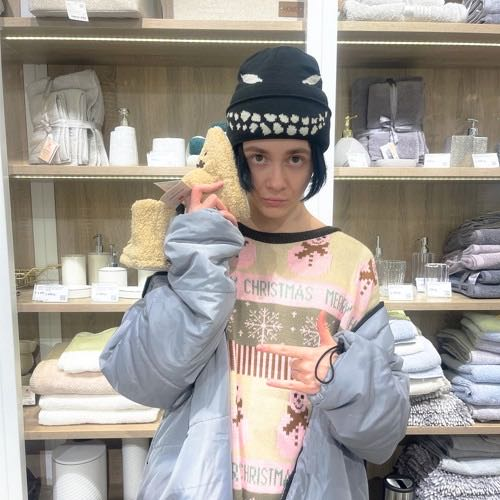</a></td>
      <td><a href="https://open.spotify.com/album/1FXzMe8UMfdkNG07ILCqbu"><strong>Cashmere</strong></a></td>
      <td><code>● LATEST SINGLE</code></td>
      <td align="center"><code>2026</code></td>
      <td align="center"><code>01:42</code></td>
      <td align="right">
        <a href="https://open.spotify.com/album/1FXzMe8UMfdkNG07ILCqbu"></a>
        <a href="https://music.apple.com/us/search?term=Radikdollar%20Cashmere"></a>
        <a href="https://soundcloud.com/radikdollar/cashmere"></a>
      </td>
    </tr>
    <tr>
      <td><code>RDK—009</code></td>
      <td align="center"><a href="https://open.spotify.com/track/1j8G2I7thSOVrIvfbuSu0c">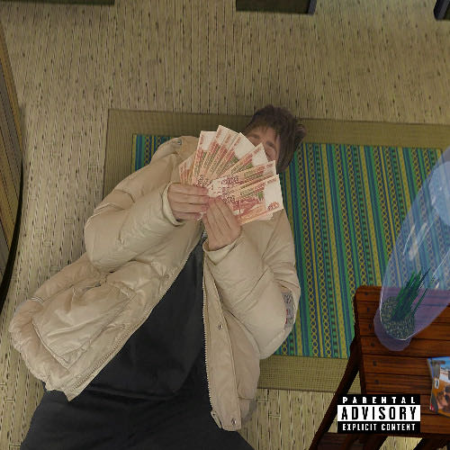</a></td>
      <td><a href="https://open.spotify.com/track/1j8G2I7thSOVrIvfbuSu0c"><strong>Bitches Kids</strong></a></td>
      <td><code>Single</code></td>
      <td align="center"><code>2025</code></td>
      <td align="center"><code>02:13</code></td>
      <td align="right">
        <a href="https://open.spotify.com/track/1j8G2I7thSOVrIvfbuSu0c"></a>
        <a href="https://music.apple.com/us/search?term=Radikdollar%20Bitches%20Kids"></a>
        <a href="https://soundcloud.com/radikdollar/bitcheskids"></a>
      </td>
    </tr>
    <tr>
      <td><code>RDK—008</code></td>
      <td align="center"><a href="https://open.spotify.com/track/1aVBmItac8DkJMI1EcIHst">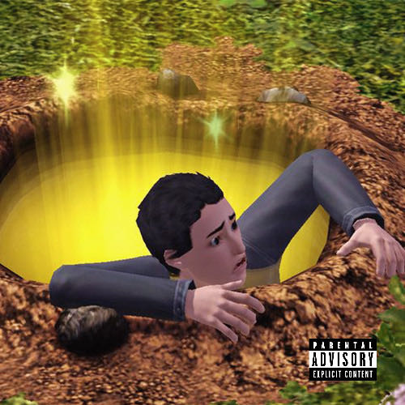</a></td>
      <td><a href="https://open.spotify.com/track/1aVBmItac8DkJMI1EcIHst"><strong>Sims</strong></a></td>
      <td><code>Single</code></td>
      <td align="center"><code>2025</code></td>
      <td align="center"><code>01:40</code></td>
      <td align="right">
        <a href="https://open.spotify.com/track/1aVBmItac8DkJMI1EcIHst"></a>
        <a href="https://music.apple.com/us/search?term=Radikdollar%20Sims"></a>
        <a href="https://soundcloud.com/radikdollar/sims"></a>
      </td>
    </tr>
    <tr>
      <td><code>RDK—007</code></td>
      <td align="center"><a href="https://open.spotify.com/track/1vEg0MvoruyuceMth9sPwF">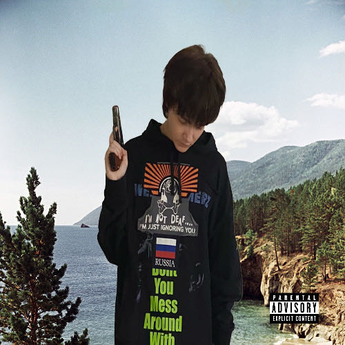</a></td>
      <td><a href="https://open.spotify.com/track/1vEg0MvoruyuceMth9sPwF"><strong>Luv Drowng</strong></a></td>
      <td><code>Single</code></td>
      <td align="center"><code>2025</code></td>
      <td align="center"><code>01:52</code></td>
      <td align="right">
        <a href="https://open.spotify.com/track/1vEg0MvoruyuceMth9sPwF"></a>
        <a href="https://music.apple.com/us/search?term=Radikdollar%20Luv%20Drowng"></a>
        <a href="https://soundcloud.com/radikdollar/luvdrowng"></a>
      </td>
    </tr>
    <tr>
      <td><code>RDK—006</code></td>
      <td align="center"><a href="https://soundcloud.com/radikdollar/memories">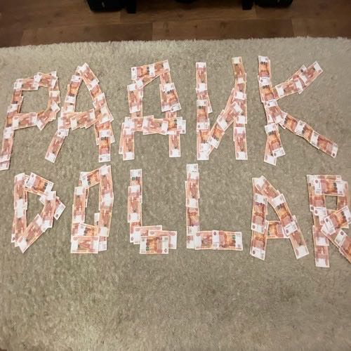</a></td>
      <td><a href="https://soundcloud.com/radikdollar/memories"><strong>Memories</strong></a></td>
      <td><code>prod. pluggikila</code></td>
      <td align="center"><code>2024</code></td>
      <td align="center"><code>01:48</code></td>
      <td align="right">
        <a href="https://open.spotify.com/artist/4XYHj8N4DsYDeOlkUkZfE7"></a>
        <a href="https://music.apple.com/us/search?term=Radikdollar%20Memories"></a>
        <a href="https://soundcloud.com/radikdollar/memories"></a>
      </td>
    </tr>
    <tr>
      <td><code>RDK—005</code></td>
      <td align="center"><a href="https://soundcloud.com/radikdollar/vendetta">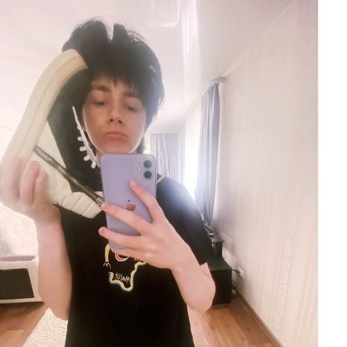</a></td>
      <td><a href="https://soundcloud.com/radikdollar/vendetta"><strong>Vendetta</strong></a></td>
      <td><code>Single</code></td>
      <td align="center"><code>2024</code></td>
      <td align="center"><code>02:04</code></td>
      <td align="right">
        <a href="https://open.spotify.com/artist/4XYHj8N4DsYDeOlkUkZfE7"></a>
        <a href="https://music.apple.com/us/search?term=Radikdollar%20Vendetta"></a>
        <a href="https://soundcloud.com/radikdollar/vendetta"></a>
      </td>
    </tr>
    <tr>
      <td><code>RDK—004</code></td>
      <td align="center"><a href="https://soundcloud.com/radikdollar/nosex">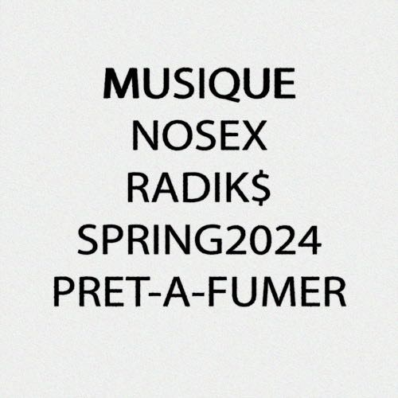</a></td>
      <td><a href="https://soundcloud.com/radikdollar/nosex"><strong>NoSex</strong></a></td>
      <td><code>Single</code></td>
      <td align="center"><code>2024</code></td>
      <td align="center"><code>02:32</code></td>
      <td align="right">
        <a href="https://open.spotify.com/artist/4XYHj8N4DsYDeOlkUkZfE7"></a>
        <a href="https://music.apple.com/us/search?term=Radikdollar%20NoSex"></a>
        <a href="https://soundcloud.com/radikdollar/nosex"></a>
      </td>
    </tr>
    <tr>
      <td><code>RDK—003</code></td>
      <td align="center"><a href="https://youtu.be/wegohty_bT4">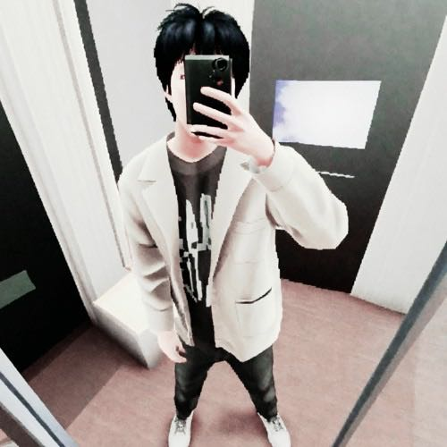</a></td>
      <td><a href="https://youtu.be/wegohty_bT4"><strong>Number Nine</strong></a></td>
      <td><code>🎬 Official Video</code></td>
      <td align="center"><code>2024</code></td>
      <td align="center"><code>01:53</code></td>
      <td align="right">
        <a href="https://open.spotify.com/artist/4XYHj8N4DsYDeOlkUkZfE7"></a>
        <a href="https://soundcloud.com/radikdollar/numbernine"></a>
        <a href="https://youtu.be/wegohty_bT4"></a>
      </td>
    </tr>
    <tr>
      <td><code>RDK—002</code></td>
      <td align="center"><a href="https://soundcloud.com/radikdollar/dirty-trench">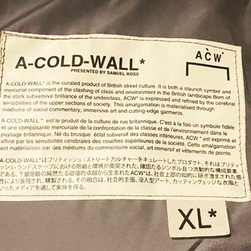</a></td>
      <td><a href="https://soundcloud.com/radikdollar/dirty-trench"><strong>Dirty Trench</strong></a></td>
      <td><code>Single</code></td>
      <td align="center"><code>2024</code></td>
      <td align="center"><code>02:08</code></td>
      <td align="right">
        <a href="https://open.spotify.com/artist/4XYHj8N4DsYDeOlkUkZfE7"></a>
        <a href="https://music.apple.com/us/search?term=Radikdollar%20Dirty%20Trench"></a>
        <a href="https://soundcloud.com/radikdollar/dirty-trench"></a>
      </td>
    </tr>
    <tr>
      <td><code>RDK—001</code></td>
      <td align="center"><a href="https://soundcloud.com/radikdollar/russiankid">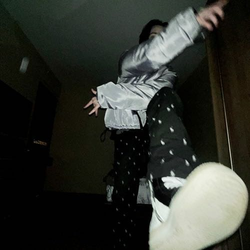</a></td>
      <td><a href="https://soundcloud.com/radikdollar/russiankid"><strong>Russian Kid</strong></a></td>
      <td><code>Debut Single</code></td>
      <td align="center"><code>2024</code></td>
      <td align="center"><code>02:26</code></td>
      <td align="right">
        <a href="https://open.spotify.com/artist/4XYHj8N4DsYDeOlkUkZfE7"></a>
        <a href="https://music.apple.com/us/search?term=Radikdollar%20Russian%20Kid"></a>
        <a href="https://soundcloud.com/radikdollar/russiankid"></a>
      </td>
    </tr>
  </tbody>
</table>

<br/>

<div align="center">

<!-- ============ 03 // OFFICIAL MUSIC VIDEO HUD: NUMBER (N)INE ============ -->
<a href="https://youtu.be/wegohty_bT4" target="_blank" rel="noopener">
  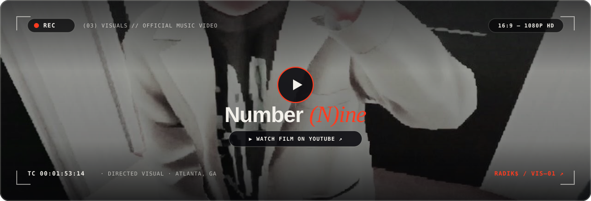
</a>

<br/><br/>

<!-- ============ 05 // ANODIZED CHROME BOOKING & MANAGEMENT PLATE ============ -->
<a href="mailto:booking@radikdollar.com">
  
</a>

</div>

<br/>

<details>
<summary><code>⚙️ REPOSITORY ARCHITECTURE // RADIKDOLLAR.COM SOURCE &amp; RUNTIME</code></summary>

<br/>

Single-page official artist platform for **Radikdollar (`RADIK$`)** — engineered with zero external frameworks, zero build step, and zero third-party network requests until video playback is triggered.

- **Stack**: Semantic HTML5 (`index.html`), Custom CSS3 3D Transforms & Variable Typography (`assets/css/main.css`), Vanilla JS + WebGL GLSL Fragment Shader (`assets/js/main.js`).
- **Interactive Modules**:
  - Custom WebGL reactive background shader + variable-font cursor proximity physics
  - 3D gyroscope & pointer-reactive Holographic Artist ID Card (`RDK—0010—26`)
  - Interactive 3D CD Jewel Case with disc-eject state machine (`Cashmere · RDK—010`)
  - Privacy-first YouTube cinema stage (`Number (N)ine`) & anodized chrome clipboard plate

```sh
python3 -m http.server 8080
# → http://localhost:8080
```

</details>
